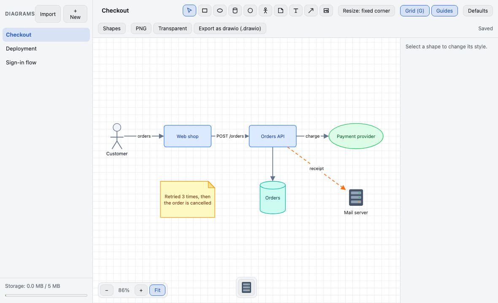
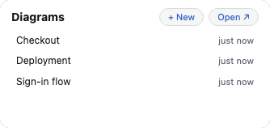
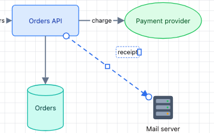
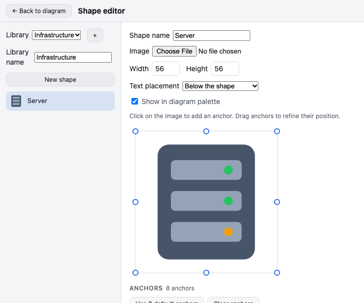
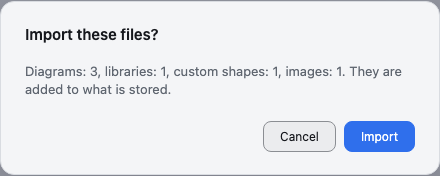

# Diagram

**Draw architecture and process diagrams: shapes, and the arrows that connect them.**

Every change is saved the moment you finish it. There is no Save button.

**Ctrl+Z** (**Cmd+Z** on a Mac) undoes the last change, and **Ctrl+Shift+Z** (**Cmd+Shift+Z**) makes it again. Every change of the diagram can be undone, up to the last 100: shapes, arrows, their style and text, groups, locks, the order, the title, the grid and the guides. Moving around the canvas, zooming and selecting are not changes. The history starts over each time you open a diagram. While you type in a field, these keys undo your typing instead.

## Contents

- [Your diagrams](#your-diagrams)
- [Drawing](#drawing)
- [Arrows](#arrows)
- [Resizing, turning and styling](#resizing-turning-and-styling)
- [Groups, locks and copies](#groups-locks-and-copies)
- [Images](#images)
- [Custom shapes](#custom-shapes)
- [Links](#links)
- [Grid, guides and zoom](#grid-guides-and-zoom)
- [Bring your diagrams from living-documentation](#bring-your-diagrams-from-living-documentation)
- [Export](#export)
- [Storage and your data](#storage-and-your-data)
- [Keyboard shortcuts](#keyboard-shortcuts)
- [When something goes wrong](#when-something-goes-wrong)

## Your diagrams

The list on the left holds your diagrams. Click **+ New** to create one: it opens at once, titled **New diagram**. Click a title to open that diagram. Rename the open diagram in the title field at the top; an empty title becomes **Untitled**.

To delete a diagram, point at it in the list and click **×**, then confirm. A deleted diagram cannot be brought back.

On the Home, the Diagram Widget lists the four diagrams you changed last, with how long ago. Click one to open it, or **+ New** to open a new diagram.

## Drawing

Pick a tool at the top, or press its key:

- **Select (S)**: click a shape or an arrow to select it, drag a shape to move it. **Ctrl+click** (**Cmd+click** on a Mac) adds a shape or an arrow to the selection or takes it out, **Ctrl+A** selects everything, and a drag on an empty spot selects what it surrounds entirely. **Delete** removes the selection: the arrows attached to a removed shape stay where they were, their ends left free. **Ctrl+Delete** (**Cmd+Delete**) also removes the arrows of the shape. **Escape** returns to this tool.
- **Rectangle (R)**, **Ellipse (E)**, **Database (D)**, **Circle (C)**, **Actor (A)**, **Post-it (P)** and **Free text (T)**: double-click an empty spot to place the shape and type its text. **Enter** applies the text, **Shift+Enter** adds a line, **Escape** abandons it. The text wraps within the width of the shape. Double-click a shape, or click **Edit text**, to change its text.
- **Arrow (F)**: press anywhere, drag and release. See below.
- **Image (I)**: double-click an empty spot and choose a picture. See below.

## Arrows

With the **Arrow** tool, press, drag and release: one gesture draws the arrow, wherever it starts. **Shift** keeps it at a multiple of 45°. A click without a drag draws nothing.

While you draw, the shape under the pointer shows its eight points: its corners and the middles of its sides, on its outline. Each end of the arrow lands where you release it:

- **on a point**, which lights up as you reach it: the end stays on that point, even when the shape turns;
- **elsewhere on a shape**: the end is automatic, and meets the outline on the way to the next point of the arrow;
- **on an empty spot**: the end is free, and stays where it is.

The arrow follows its shapes when you move, resize or turn them. Several arrows between the same two shapes are drawn side by side, and arrows that share a point spread out from it, so that each stays visible. Click anywhere on an arrow's line to select it.

A selected arrow shows a handle at each end: drag one onto another point or shape, or onto an empty spot to free it. An arrow whose two ends are free moves when you drag its line. **Detach ends**, in the panel, makes the ends attached to a point automatic.

You cannot attach an arrow to a locked shape: an end released on it stays free.

### Routes and waypoints

In the panel of a selected arrow, choose its route:

- **Straight**: straight lines, from point to point;
- **Curved**: a smooth curve through its points;
- **Elbow**: horizontal and vertical segments only, which leave each shape at a right angle to its side.

A selected arrow shows a small square in the middle of each segment. Drag it to add a waypoint there, and give the arrow a corner. On an elbow arrow, dragging the square of a segment between two corners moves that segment sideways. Drag a waypoint to move it: it lines up exactly with its neighbor when you bring it close to the same height or the same column. Double-click a waypoint to remove it, or click **Reset route** to remove them all.

Waypoints stay where you put them when you move a shape: only the segments at the ends of the arrow follow it.

### Style and label

The panel of the selected arrows styles them all at once: their arrowheads (none, at the start, at the end or at both ends), a **Solid** or **Dashed** line, its width, from 1 to 8 by steps of 0.5, and its color.

Double-click an arrow or its label, or click **Edit arrow label**, to write its label. **Enter** applies it, **Shift+Enter** adds a line, **Escape** abandons it. The label sits on a background that hides the line under it.

Drag the label to slide it along the arrow, or away from it on either side: it keeps its place on the arrow when the arrow moves. On a selected arrow, the small handle on the right edge of the label sets the width its lines wrap within. The panel sets the size of its text, from 6 to 72, and turns it by steps of 15°. **Reset label** brings it back to the middle of the arrow, at its automatic width.

## Resizing, turning and styling

Drag a corner of the selected shape to resize it. Hold **Shift** to keep its proportions; an actor and a circle always keep them. The button at the top chooses whether the opposite corner or the center stays in place.

Drag the round handle above the shape to turn it (**Shift** turns by steps of 15°), or use the rotation buttons of the panel, by 10°. The handle marked **T** turns the text alone.

The panel on the right styles every selected shape: its color, the opacity of its background, the size and alignment of its text, and whether it is in front of or behind the others.

Select a shape and click **Copy style** (**Ctrl+Alt+C**, **Cmd+Option+C** on a Mac) to copy its color, the opacity of its background, and the size and alignment of its text; tick **with size** to copy its width and height too. Then select other shapes and click **Paste style** (**Ctrl+Alt+V**, **Cmd+Option+V**). An arrow's style is copied the same way, onto other arrows: its arrowheads, its line, its width, its color, the size of its label and its route.

### Default styles

**Defaults** in the toolbar opens **Diagram defaults**: the arrowheads, line, route, width, color and label size of new arrows, and the width, height, text size and color of new shapes of each built-in type. Sizes go from 10 to 800, and text from 6 to 72: a value out of bounds is outlined in red, and nothing is saved until it is corrected. **Reset** brings back the factory values, saved when you click **Save**. A circle and an actor keep their proportions: their height follows their width.

To start from a shape you styled, select it and click **Save as default for this shape type**; on an arrow, **Save as default for arrows**. Defaults change only the shapes and arrows you create afterwards, never those already drawn. Custom shapes keep the size of their definition.

## Groups, locks and copies

Select at least two shapes and click **Group selection**. A click on a member of the group then selects the whole group, outlined by a dashed line: it moves, resizes by its corners and takes a style as one block. **Alt+click** (**Option+click** on a Mac) selects a member alone. **Ungroup** undoes the groups of the selection.

Click **Lock** to protect the selected shapes or arrows. A locked item is still selected by a click, with a padlock, but it can no longer be moved, resized or deleted, and its panel offers only **Unlock**. A selection rectangle and **Ctrl+A** leave locked items out.

**Ctrl+C** (**Cmd+C**) copies the selected shapes, with the arrows between them. **Ctrl+V** (**Cmd+V**) pastes them, a little further down and to the right each time. A pasted group is a new group, apart from the one it was copied from.

## Images

With the **Image** tool, double-click an empty spot and choose a picture: it is placed there. **Ctrl+V** (**Cmd+V**) pastes a picture you copied elsewhere, such as a screenshot, in the middle of the view.

The picture comes with its caption below it: the name of its file without its extension, or **image** for a pasted picture. The two form a group; double-click the caption to change it like any text, or **Ungroup** them.

A picture is reduced to 1600 pixels on its longest side and stored once, however many times you place it. A picture still larger than about 900 KB, or one that would fill the storage, is refused with a message, and nothing is placed: try a smaller one.

If a picture can no longer be found in the storage, its place shows a **missing image** frame.

## Custom shapes

Click **Shapes** in the toolbar to open the shape editor, and **← Back to diagram** to return. Shapes are kept in libraries: pick one in **Library**, create another with **+**, and rename it in **Library name**.

Click **New shape** and choose its **Image**: the shape is saved as soon as it has one, and every change after that is saved as you make it. Give it a name, a width and a height (16 to 1200), and choose where its text goes: below, above, to the right, to the left, or centered on the picture.

Its anchors are the points where arrows attach to it. Click the preview to add one, drag it to move it, and rename or remove it in the list; two anchors never share a name. **Use 8 default anchors** puts back the corners and the middles of the sides. **Clear anchors** leaves none: arrows then attach to the shape automatically only.

The shapes ticked **Show in diagram palette** appear at the bottom of the canvas. Click one, then double-click the canvas to place it, at its size and with its name as its text. The panel changes where its text goes on that shape alone. A change made in the editor, to its picture or its anchors, shows on every shape already placed; untick **Show in diagram palette** to stop offering it without changing them.

**Delete shape** asks first, and tells you how many diagrams use it. There, it then shows as a dashed frame with its name, and its arrows stay attached.

## Links

A shape can lead to a web page or to another diagram. Select it alone and click **Link…** in its panel, then choose:

- **External URL**: type the address; without `http://`, `https://`, `mailto:` or `tel:`, `https://` is added. Leave it empty to remove the link;
- **Existing diagram**: choose it in the list, which does not offer the diagram you are in;
- **New diagram**: type its title, which is required. The diagram is created empty.

A linked shape shows a chain at its bottom right corner, blue for a page and orange for a diagram. **Shift+click** it to follow the link, with any tool but the Arrow: a page opens in a new tab, and a diagram opens in its place. **← Back to "…"**, at the top left of the canvas, returns to the diagram you came from, one link at a time; opening a diagram from the list forgets the way back. **Remove link**, in the same panel, takes the link away. A link is saved like any other change, and **Ctrl+Z** undoes it.

## Grid, guides and zoom

A shape you move snaps to the **Grid**, every 20 units; press **G** or click **Grid (G)** to turn it off or on. While you move a shape, **Guides** line it up with the edges and centers of the other shapes, and show the line it follows; they win over the grid. Both are on in a new diagram, and each diagram keeps its own choice.

To move around the canvas, use the wheel, or drag while holding **Space** or the middle button. **Ctrl+wheel** (**Cmd+wheel** on a Mac) zooms, as do the **−** and **+** buttons at the bottom left, beside the zoom level. **Fit** shows the whole drawing.

## Bring your diagrams from living-documentation

The diagrams you drew in the editor of living-documentation can come with you. Its project folder holds them in two files, `.diagrams.json` for the diagrams and `.shape-libraries.json` for the libraries of custom shapes, and their pictures in its `images/` folder.

Click **Import**, above the list of diagrams, and choose these files together: one or both JSON files, and the pictures they use. Pick every file of `images/` if you are not sure which ones are used: those the diagrams do not use are left out.

Before anything is written, a confirmation tells you how many diagrams, libraries, custom shapes and images will be imported, and names the pictures that the diagrams use but that you did not choose. Click **Import** to go on, or **Cancel** to import nothing. The first imported diagram then opens.

The import adds to what you have, and never replaces it: each diagram gets a new identity, even one you already imported, and links between the imported diagrams lead to their new copies. Shapes, arrows, their style and text, groups, locks, links, the grid and the guides are all kept. An arrow that ends on an anchor node of living-documentation gets a free end there, and the curves of the original become the **Curved** route. A picture you did not choose shows as a **missing image** frame.

Nothing is imported when:

- you chose only pictures, or files that hold no diagram and no library: the message says there is nothing to import;
- a file is not JSON, or is neither a `.diagrams.json` nor a `.shape-libraries.json` file: the message names it;
- the import would fill the storage: delete pictures or diagrams you no longer need, or import fewer files at once.

## Export

**PNG**, in the toolbar, or **Ctrl+Shift+E** (**Cmd+Shift+E** on a Mac), downloads the selected shapes as an image, with the arrows between them, or the whole diagram when nothing is selected. It is drawn from the diagram itself, so what is outside the view is included, at twice its size for sharpness. Its background is that of the current theme; turn on **Transparent** to leave it out.

**Export as drawio (.drawio)** downloads the whole diagram as a file that draw.io (app.diagrams.net) opens: its shapes and their text, its groups, its arrows with the points they are attached to and their waypoints, their labels, and its pictures, held in the file itself. draw.io cannot turn a text apart from its shape: such turns are dropped, and a message tells you how many.

The file is named after the diagram's title. Exporting does not change the diagram.

## Storage and your data

Your diagrams and their pictures are kept in Tessello's storage on your computer, and nowhere else. The Diagram Module contacts no server. Uninstalling it deletes your diagrams.

The Module has 5 MB of storage for everything: your diagrams, your libraries of shapes, and the pictures of your images and custom shapes. Pictures take most of it: shapes and arrows take little room, but a single picture can take up to about 900 KB.

The gauge below the list of diagrams, **Storage: x.x MB / 5 MB**, shows how much of it the Module uses; it turns red past 80%. When the storage is full, a change cannot be saved, and a picture or an import that would not fit is refused. To make room, delete the pictures, custom shapes or diagrams you no longer need.

A picture is removed from the storage once no diagram uses it, and it can no longer be brought back by **Ctrl+Z**: when you open another diagram, or the next time the Diagram Module starts. A picture placed several times is stored only once.

## Keyboard shortcuts

On a Mac, use **Cmd** for **Ctrl** and **Option** for **Alt**. The shortcuts do not work while you type in a text, a field or a dialog.

| Keys | What they do |
|---|---|
| **S**, **R**, **E**, **D**, **C**, **A**, **P**, **T**, **F**, **I** | Select, Rectangle, Ellipse, Database, Circle, Actor, Post-it, Free text, Arrow, Image |
| **Escape** | Back to Select, with nothing selected |
| **Ctrl+A** | Select everything that is not locked |
| **Ctrl+click** | Add a shape or an arrow to the selection, or take it out |
| **Alt+click** | Select a member of a group alone |
| **Shift+click** | Follow the link of a shape |
| **Delete** or **Backspace** | Delete the selection; the arrows of a deleted shape stay, with free ends |
| **Ctrl+Delete** | Delete the selection, with the arrows of its shapes |
| **Ctrl+C**, **Ctrl+V** | Copy the selection, paste it; paste a copied picture |
| **Ctrl+Alt+C**, **Ctrl+Alt+V** | Copy the style of the selection, paste it |
| **Ctrl+Z**, **Ctrl+Shift+Z** | Undo, redo |
| **G** | Turn the grid off or on |
| **Ctrl+Shift+E** | Export the selection, or the whole diagram, as a PNG |
| **Space** + drag, or middle button + drag | Move around the canvas |
| **Ctrl+wheel** | Zoom |
| **Shift** while drawing an arrow | Keep it at a multiple of 45° |
| **Shift** while resizing or turning | Keep the proportions, turn by steps of 15° |
| **Enter**, **Shift+Enter**, **Escape** in a text | Apply it, add a line, abandon it |

## When something goes wrong

- **Save failed**: your last change is still on screen, but it is not saved and will be lost when you leave. The message tells you why; when the storage is full, delete pictures or diagrams you no longer need.
- **Diagram not found**: the diagram a shape leads to was deleted. Click **Remove link**, or link the shape to another diagram.
- **The export failed**: no file was downloaded. The message tells you why; try again.
- **The import failed**: the message tells you why. Part of the import may have been saved: look at the list of diagrams before you try again, since an import adds copies and never replaces what is there. See also [Bring your diagrams from living-documentation](#bring-your-diagrams-from-living-documentation).
- **Your diagrams could not be read**: nothing can be changed until they are read, so that nothing is lost. Click **Try again**.
